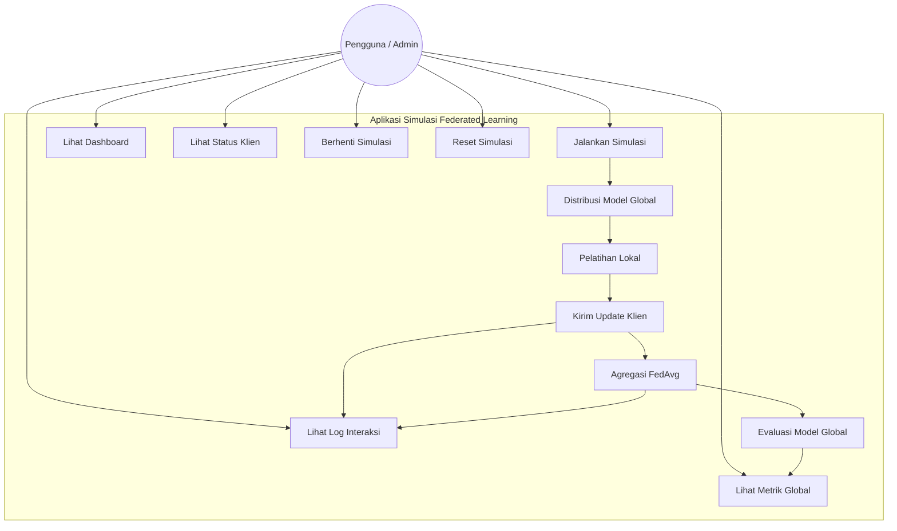
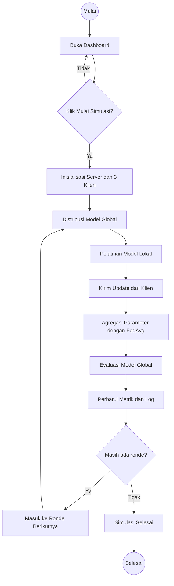
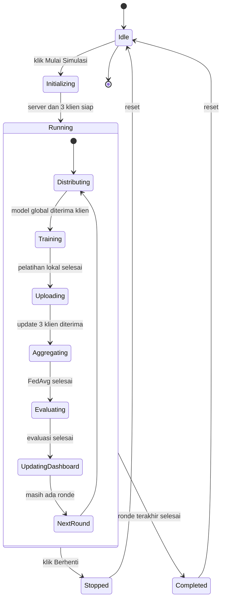
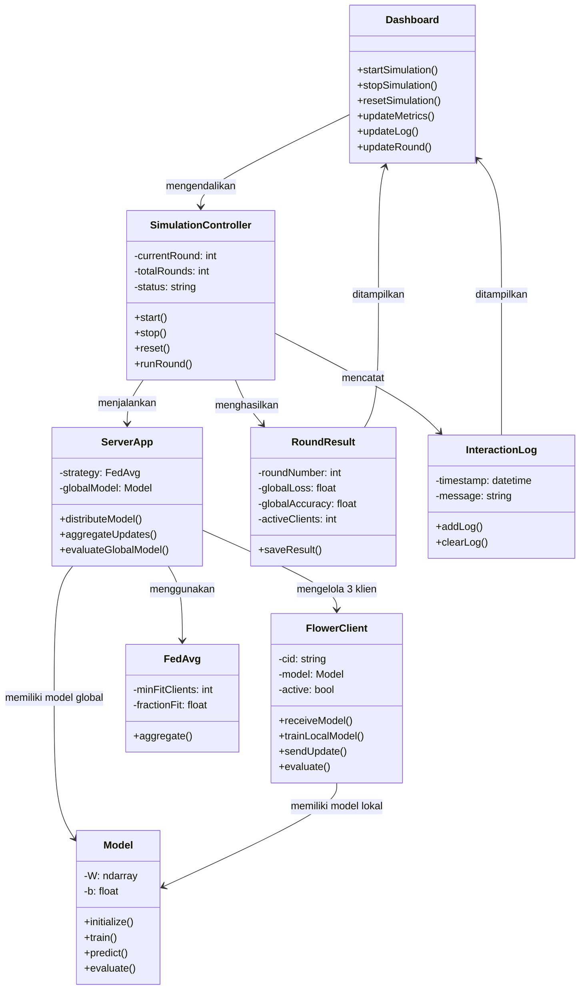
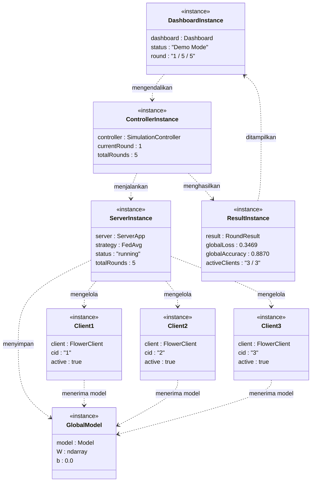
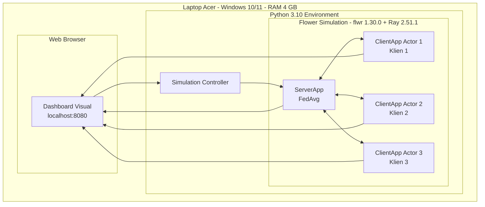
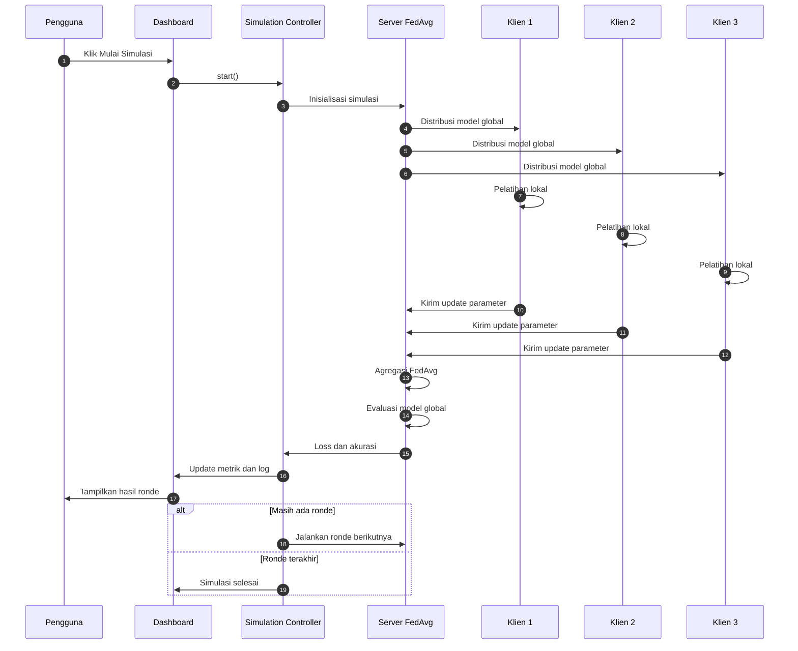
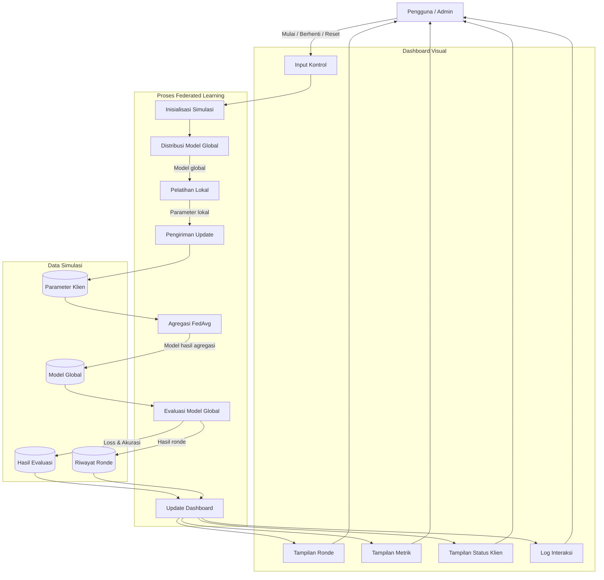
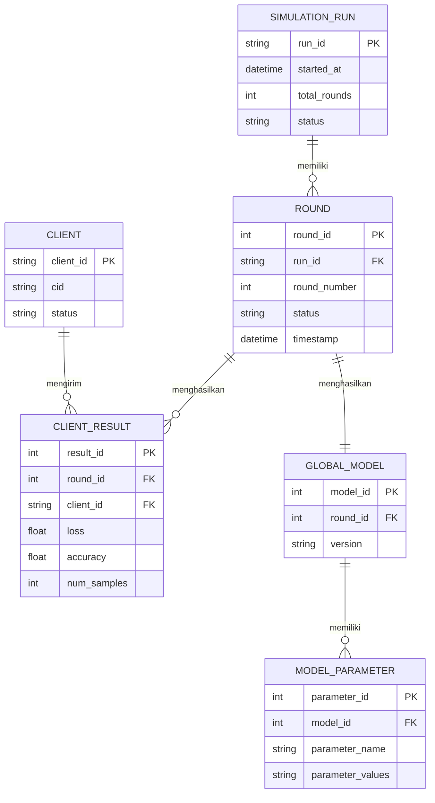

# UML Diagram — Simulasi Federated Learning (Flower + NumPy)

## 1. Use Case Diagram

---

## 2. Activity Diagram

---

## 3. State Machine Diagram

---

## 4. Class Diagram

---

## 5. Object Diagram

---

## 6. Deployment Diagram

---

## 7. Sequence Diagram

---

## 8. Data Flow Diagram (DFD)

---

## 9. Entity Relationship Diagram (ERD)

